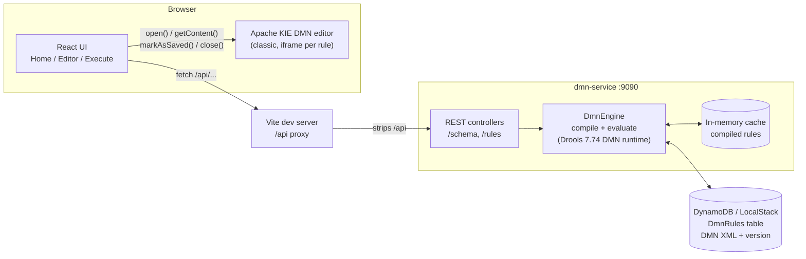
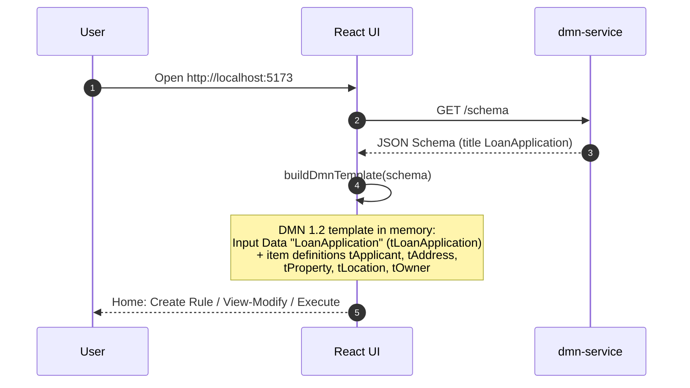
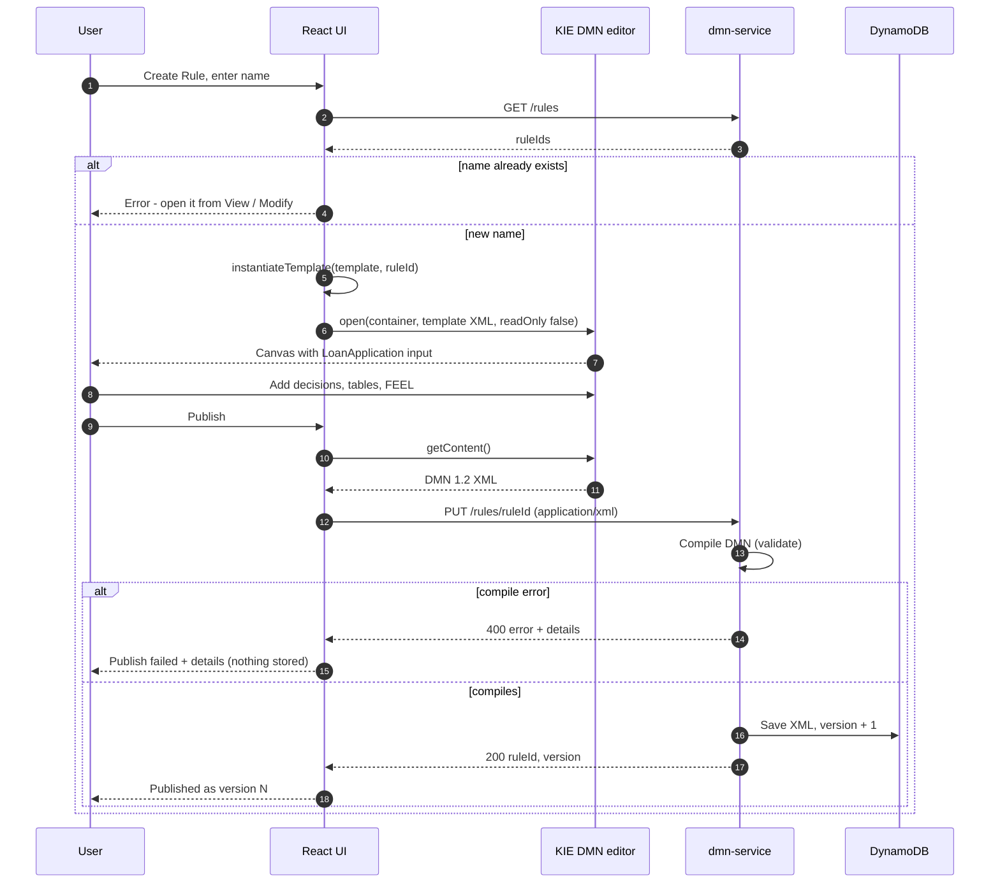
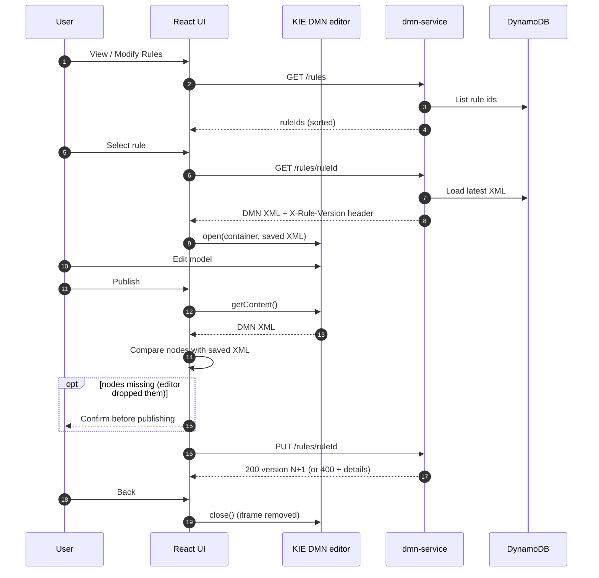
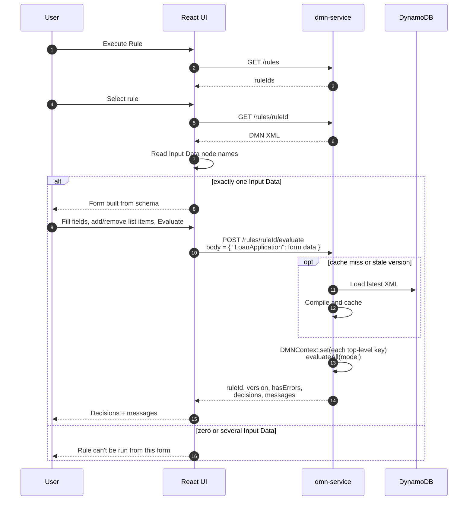

# UI ↔ Backend flows

How the React UI (`dmn-drool-ui`) and `dmn-service` work together to create, list, edit, publish and evaluate rules.

Rendered PNGs (regenerate after editing a diagram, see below): [components](diagrams/1-components.png) ·
[app start](diagrams/2-app-start.png) · [create → publish](diagrams/3-create-publish.png) ·
[list → modify → publish](diagrams/4-list-modify-publish.png) · [evaluate](diagrams/5-evaluate.png)

## 1. Components



## 2. App start: schema → DMN template



## 3. Create rule → publish

Core flow only. Not shown: `subscribeToContentChanges` / `markAsSaved` (they power the unsaved-changes indicator and leave warnings, not publishing).



## 4. List → open → modify → publish



## 5. Evaluate



Key rule for evaluate: the body's top-level keys must equal the rule's Input Data node names.
`{"LoanApplication": {...}}` works; the bare `{...}` fails with `Required dependency 'LoanApplication' not found`.

## Regenerating the PNGs

```bash
npx -y @mermaid-js/mermaid-cli@11.4.2 -i docs/flows.md -o docs/diagrams/flow.png -b white -s 2
```
This writes one `flow-N.png` per diagram; rename to the names above. If Puppeteer has no browser, add
`-p puppeteer.json` containing `{"executablePath": "/Applications/Google Chrome.app/Contents/MacOS/Google Chrome"}`.
