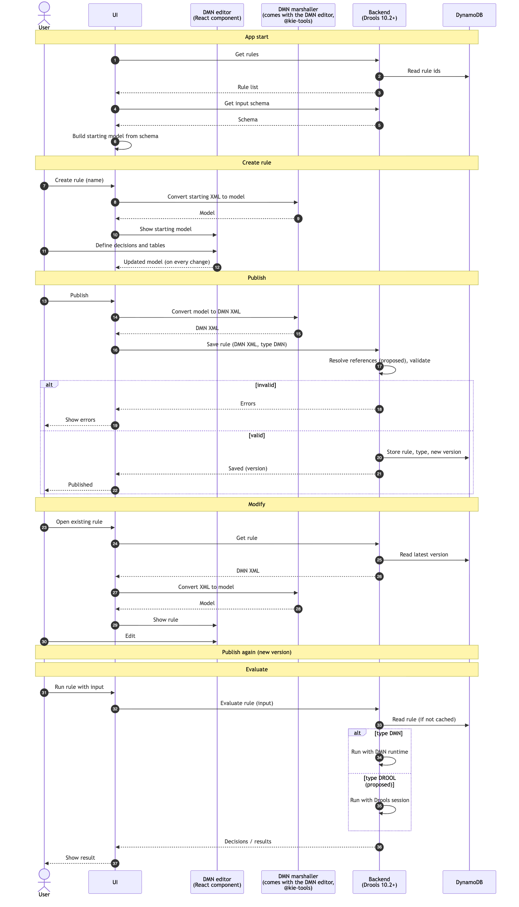
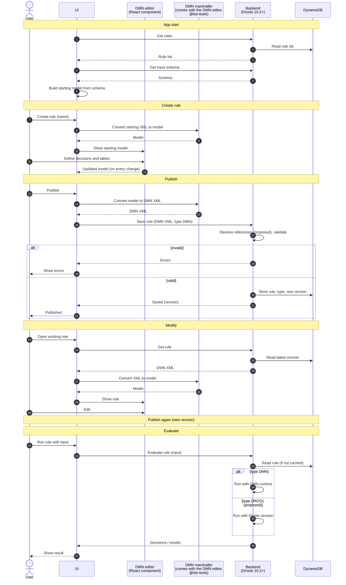
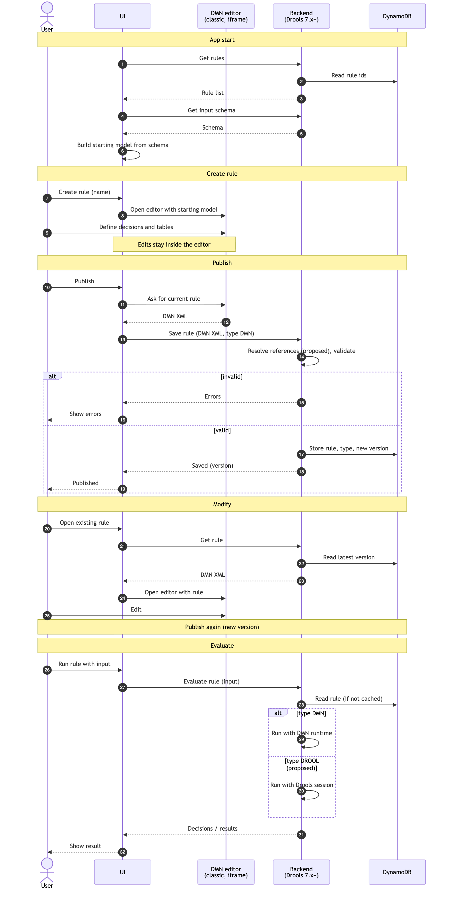
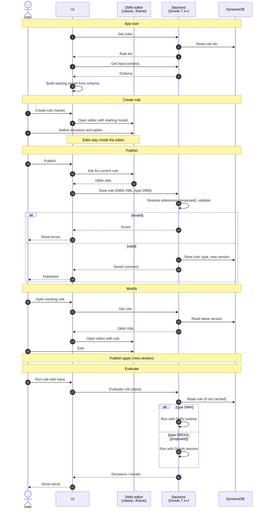

# Rule lifecycle: sequence diagrams

How a rule is created, published, modified and evaluated across the UI, the DMN editor, the backend and DynamoDB.
Two diagrams, because the editor part differs:

| | A. React component editor | B. Classic iframe editor (current app) |
|---|---|---|
| Who holds the rule while editing | The UI | The editor |
| How the UI gets the rule | Editor sends every change to the UI | UI asks the editor on Publish |
| Converting to XML | UI calls the DMN marshaller, which comes with the DMN editor (both `@kie-tools`) | Editor returns XML |
| Backend needed | Drools 10.2+ | Any Drools 7.x+ |

Steps marked *(proposed)* are not built yet.

## A. React component editor (target)

## B. Classic iframe editor (current app)

